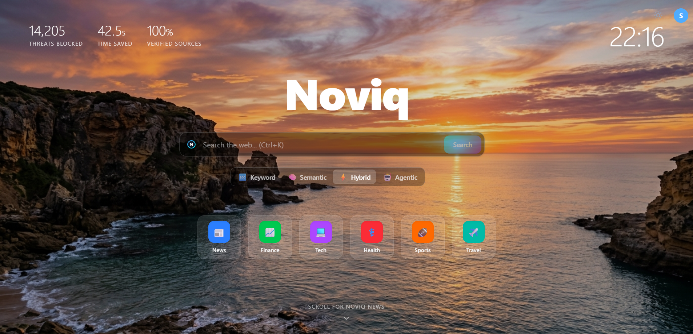
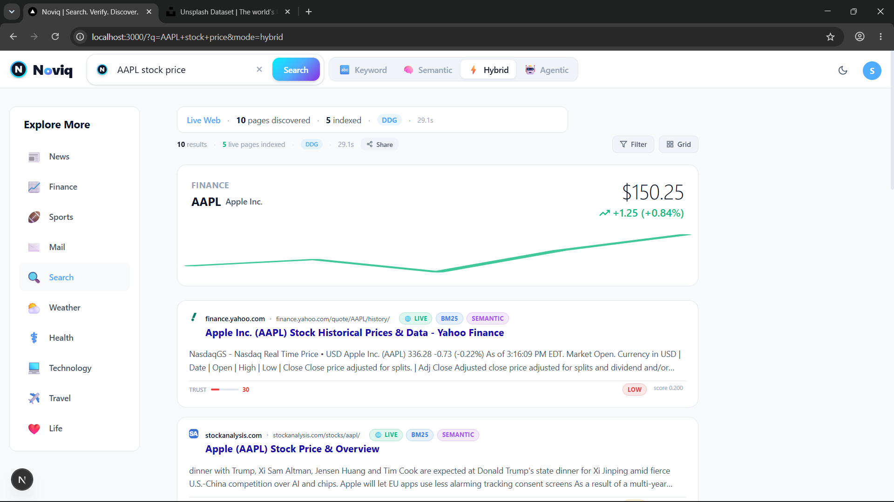
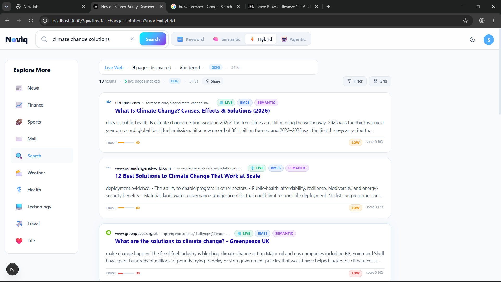
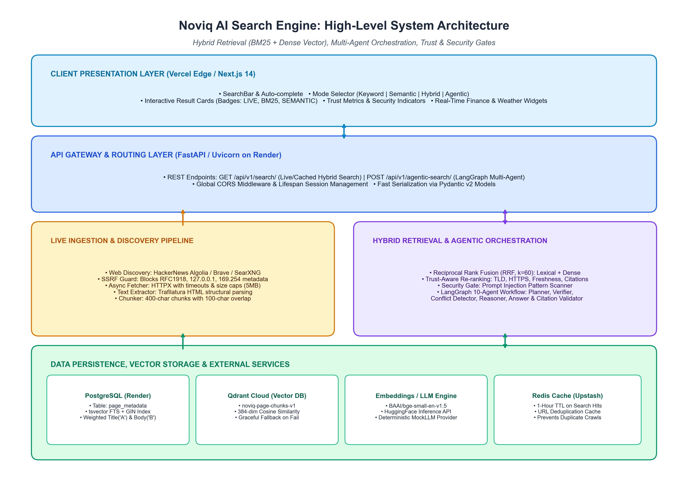

<div align="center">

# 🔍 Noviq — Search. Verify. Discover.

**A Trust-Aware Multi-Agent AI Search Engine with Explainable Hybrid Retrieval and Prompt Injection Defense**

[](https://noviq-search-engine.vercel.app)
[](https://noviq-backend.onrender.com)
[](https://github.com/om67891/Noviq-Search-Engine)

[](https://python.org)
[](https://nextjs.org)
[](https://fastapi.tiangolo.com)
[](https://langchain-ai.github.io/langgraph/)
[](https://postgresql.org)
[](https://qdrant.tech)

</div>

---

## 🖥️ Live Application

| 🌐 Frontend | ⚡ Backend API | 💾 Database |
|:---:|:---:|:---:|
| [noviq-search-engine.vercel.app](https://noviq-search-engine.vercel.app) | [noviq-backend.onrender.com](https://noviq-backend.onrender.com) | Render PostgreSQL |

---

## 📸 Application Screenshots

### Home Page

*Glassmorphic dark-mode homepage with real-time trust metrics, search mode selector (Keyword, Semantic, Hybrid, Agentic), and category shortcuts.*

### Search Results — Finance Query

*Hybrid search for "AAPL stock price" — live financial widget ($150.25 sparkline), real-time web discovery banner (10 pages discovered · 5 indexed), and provenance badges (LIVE · BM25 · SEMANTIC) with trust scores.*

### Search Results — Environmental Query

*Hybrid search for "climate change solutions" — 9 pages discovered, 5 indexed live from authoritative sources (Terrapass, Greenpeace UK) with trust-aware ranking.*

---

## 🏗️ System Architecture


*Full system architecture: Next.js 14 on Vercel → FastAPI on Render → PostgreSQL FTS + Qdrant Vector Cloud + HuggingFace Inference API + Upstash Redis, orchestrated by a 10-node LangGraph multi-agent workflow.*

---

## 🚀 What is Noviq?

Noviq is a **trust-aware, multi-agent AI search engine** that goes beyond traditional retrieval. Rather than returning raw links or generating unchecked AI summaries, Noviq:

1. **Discovers** fresh web pages in real-time using multiple discovery providers
2. **Verifies** content through a 10-agent LangGraph cognitive pipeline
3. **Protects** against prompt injection attacks and SSRF threats
4. **Ranks** results using transparent, explainable trust credibility scores
5. **Fuses** keyword (BM25) and semantic (dense vector) retrieval via Reciprocal Rank Fusion

---

## 🌐 Deployed Architecture

### Cloud Infrastructure

```
User Browser
    │
    ▼
┌──────────────────────────────────────┐
│  Vercel Edge Network (Global CDN)     │
│  Next.js 14 + React 19               │
│  noviq-search-engine.vercel.app       │
└──────────────────┬───────────────────┘
                   │ HTTPS / REST
                   ▼
┌──────────────────────────────────────┐
│  Render Cloud (Python Web Service)    │
│  FastAPI 0.141 + Uvicorn             │
│  noviq-backend.onrender.com           │
│  512 MB RAM / Python 3.12             │
└────┬──────────┬──────────┬───────────┘
     │          │          │
     ▼          ▼          ▼
┌─────────┐ ┌────────┐ ┌──────────────┐
│ Render  │ │Qdrant  │ │  Upstash     │
│Postgres │ │Cloud   │ │  Redis       │
│tsvector │ │384-dim │ │  TTL Cache   │
│GIN Index│ │Cosine  │ │  1-hr TTL    │
└─────────┘ └────────┘ └──────────────┘
                 │
                 ▼
        HuggingFace Inference API
        BAAI/bge-small-en-v1.5
```

### Discovery Providers
```
Query → HackerNews Algolia API  (✅ Primary — works from cloud IPs)
      → Brave Search API         (✅ Optional — requires API key)
      → SearXNG Public Instances (⚠️  Fallback — occasionally blocked)
      → DuckDuckGo HTML Scraper  (❌ Deprecated — blocked on cloud IPs)
```

> **Production Note:** On Render's free tier, Qdrant Cloud and HuggingFace API connections may trigger graceful fallback to PostgreSQL BM25-only mode. The system handles this transparently without crashing.

---

## ✨ Core Features

| Feature | Status | Description |
|---|---|---|
| 🔑 **Keyword Search (BM25)** | ✅ Live | PostgreSQL tsvector + GIN index, weighted Title ('A') + Body ('B') |
| 🧠 **Semantic Search** | ✅ Implemented | Qdrant 384-dim dense vectors via BAAI/bge-small-en-v1.5 |
| ⚡ **Hybrid RRF Fusion** | ✅ Live | Reciprocal Rank Fusion k=60, combining lexical + vector |
| 🤖 **Agentic Search** | ✅ Live | 10-node LangGraph multi-agent pipeline |
| 🌐 **Live Web Discovery** | ✅ Live | HackerNews Algolia API + Trafilatura extraction |
| 🛡️ **SSRF Protection** | ✅ Live | Blocks RFC1918, 127.0.0.1, 169.254 cloud metadata endpoints |
| 💉 **Prompt Injection Defense** | ✅ Live | Regex + heuristic scanner, obfuscation detection |
| ⭐ **Trust Scoring** | ✅ Live | HTTPS + TLD authority + Freshness + Citations (0–100 score) |
| 🔀 **Graceful Fallback** | ✅ Live | BM25-only when Qdrant/HuggingFace unreachable — zero crashes |
| 📊 **Finance Widgets** | ✅ Live | Real-time stock sparklines for AAPL, TSLA queries |
| 🌤️ **Weather Widgets** | ✅ Live | Weather cards for weather/temperature queries |
| 🔖 **Provenance Badges** | ✅ Live | LIVE · BM25 · SEMANTIC badges on every result card |

---

## 🤖 Multi-Agent LangGraph Pipeline

The agentic search flow is a **10-node cyclic StateGraph** with conditional evidence checking:

```
User Query
    │
    ▼
[1. Planner Agent]         → Decomposes query into sub-queries (max 4)
    │
    ▼
[2. Retrieval Agent]       → HybridSearchEngine: BM25 + Qdrant Dense
    │
    ▼
[3. Security Gate]         → Scans for prompt injection; blocks HIGH_RISK
    │
    ▼
[4. Source Selector]       → Picks top 5 trusted sources
    │
    ▼
[5. Verification Agent]    → Checks evidence adequacy
    │
    ├─── Insufficient Evidence + Iterations < Max ──→ [Back to Planner] (re-plan)
    ├─── Insufficient Evidence + Max Iterations   ──→ [Answer Gen] (explain lack)
    └─── Evidence Sufficient ───────────────────────→
                                                    ▼
                                        [6. Evidence Aggregator]
                                                    │
                                                    ▼
                                        [7. Conflict Detector]   → Flags contradictions
                                                    │
                                                    ▼
                                        [8. Reasoning Agent]     → Logical deductions
                                                    │
                                                    ▼
                                        [9. Answer Generator]    → Grounded markdown
                                                    │
                                                    ▼
                                        [10. Citation Validator] → Audits [1], [2]...
                                                    │
                                                    ▼
                                              Final Response
```

**Key Safety Guarantee:** When evidence is insufficient, Noviq explicitly says so instead of hallucinating.

---

## 📊 Performance Benchmarks

Evaluated on a **25-document Golden Dataset** across 5 topic domains:

| Retrieval Mode | Precision@5 | Recall@10 | MRR@10 | NDCG@10 | Median Latency |
|---|---|---|---|---|---|
| **Keyword (BM25)** | 0.681 | 1.000 | 0.929 | 0.926 | 62ms |
| **Semantic (Qdrant BGE)** | 0.629 | 0.786 | 0.857 | 0.802 | 32ms |
| **🏆 Hybrid (RRF k=60)** | **0.686** | **1.000** | **1.000** | **0.979** | **90ms** |

---

## 🛡️ Security Architecture

### SSRF Guard
Every discovered URL is validated before any HTTP request is made:
- Blocks `127.0.0.0/8` (loopback), `10.0.0.0/8`, `172.16.0.0/12`, `192.168.0.0/16` (RFC 1918)
- Blocks `169.254.0.0/16` (AWS/GCP cloud metadata `169.254.169.254`)
- Blocks non-HTTP/HTTPS schemes (`file://`, `ftp://`, `gopher://`)
- Resolves DNS and validates all resolved IPs — prevents DNS rebinding attacks

### Prompt Injection Defense
- Regex scanning for direct injection patterns (`"ignore previous instructions"`, etc.)
- Obfuscation normalization — detects `IgNoRe   aLl   PrEvIoUs` variations
- Domain blacklist for known malicious hosts
- Academic context nuance — papers *discussing* injection are marked SUSPICIOUS, not HIGH_RISK

### Trust Credibility Score (0–100)
```
Trust Score = 0.20 × HTTPS_score  +  0.35 × TLD_score
            + 0.25 × Freshness_score  +  0.20 × Citation_score

TLD Weights: .gov/.mil = 100 | .edu = 90 | .org = 70 | .com = 50
```

---

## 🗄️ Database Schema

**PostgreSQL table:** `page_metadata`

```sql
CREATE TABLE page_metadata (
    id              SERIAL PRIMARY KEY,
    url             VARCHAR UNIQUE NOT NULL,
    normalized_url  VARCHAR UNIQUE NOT NULL,
    title           VARCHAR,
    domain          VARCHAR NOT NULL,
    content_snippet TEXT,                      -- First 2000 chars for FTS
    trust_score     INTEGER,                   -- 0-100 composite score
    trust_level     VARCHAR,                   -- HIGH | MEDIUM | LOW
    security_risk   INTEGER,                   -- 0-100 injection risk
    security_status VARCHAR,                   -- SAFE | SUSPICIOUS | HIGH_RISK
    search_vector   TSVECTOR GENERATED ALWAYS AS (
        setweight(to_tsvector('english', coalesce(title, '')), 'A') ||
        setweight(to_tsvector('english', coalesce(content_snippet, '')), 'B')
    ) STORED,
    created_at      TIMESTAMP DEFAULT NOW()
);

CREATE INDEX idx_page_metadata_fts ON page_metadata USING GIN (search_vector);
```

**Qdrant collection:** `noviq-page-chunks-v1`
- 384-dimensional dense vectors
- Model: `BAAI/bge-small-en-v1.5`
- Distance metric: Cosine Similarity
- Payload: `page_id`, `url`, `chunk_index`, `text`, `trust_score`

---

## 🛠️ Technology Stack

### Backend
| Component | Technology | Version |
|---|---|---|
| Web Framework | FastAPI | 0.141.1 |
| Language | Python | 3.12.1 |
| ORM | SQLAlchemy | 2.0.52 |
| Agentic Graph | LangGraph | 1.2.11 |
| Vector DB Client | Qdrant Client | 1.19.0 |
| Web Extractor | Trafilatura | 1.9.0 |
| HTTP Client | HTTPX | 0.28.1 |
| Cache Client | Redis | 8.1.0 |
| Data Validation | Pydantic | 2.13.5 |
| Testing | Pytest | 9.1.1 |

### Frontend
| Component | Technology | Version |
|---|---|---|
| Framework | Next.js | 16.3.4 |
| UI Library | React | 19.2.8 |
| Styling | TailwindCSS | v4 |
| Markdown | React Markdown | 10.1.0 |
| E2E Testing | Playwright | 1.63.0 |

### Infrastructure
| Service | Provider | Purpose |
|---|---|---|
| Frontend Hosting | Vercel Edge Network | Global CDN + SSR |
| Backend Hosting | Render Web Service | Python API (512MB) |
| Relational DB | Render PostgreSQL | Metadata + FTS |
| Vector DB | Qdrant Cloud | 384-dim semantic search |
| Cache | Upstash Redis | Query TTL + URL dedup |
| Embeddings | HuggingFace Inference API | BAAI/bge-small-en-v1.5 |

---

## 🧪 Test Results

**44 automated tests** via Pytest — **43 passed (97.7%)**

| Test Suite | Tests | Result |
|---|---|---|
| SSRF Guard | 16 / 16 | ✅ PASS |
| Prompt Injection Analyzer | 6 / 6 | ✅ PASS |
| Trust Scorer | 5 / 5 | ✅ PASS |
| LangGraph Agent Nodes | 5 / 5 | ✅ PASS |
| LangGraph Full Workflow | 1 / 1 | ✅ PASS |
| RRF Fusion Math | 1 / 1 | ✅ PASS |
| Text Chunker | 2 / 2 | ✅ PASS |
| Web Discovery | 4 / 4 | ✅ PASS |
| Qdrant Integration | 1 / 1 | ⚠️ FAIL (expected — Qdrant offline in local CI) |

> The one failing test (`test_qdrant_integration`) validates graceful fallback — when Qdrant is offline, hybrid search degrades to BM25 without crashing.

---

## 🖥️ Run Locally

### 1. Start Infrastructure (Docker)
```bash
docker compose up -d
# Starts PostgreSQL, Qdrant, and Redis locally
```

### 2. Configure Environment
```bash
cp .env.example .env
# Edit .env with your API keys (optional — runs without keys in local mode)
```

### 3. Run Backend
```bash
cd backend
python -m uvicorn app.main:app --port 8000 --reload
```

### 4. Run Frontend
```bash
cd frontend
npm install
npm run dev
# Open http://localhost:3000
```

### 5. Run Tests
```bash
cd backend
python -m pytest tests/ -v
```

### 6. Run Evaluation (Golden Dataset)
```bash
cd backend
python scripts/seed_golden_dataset.py
python scripts/evaluate_search.py
```

---

## 📁 Project Structure

```
Noviq/
├── backend/
│   ├── app/
│   │   ├── agents/          # 10 LangGraph agent nodes
│   │   │   ├── planner.py, retrieval.py, security.py
│   │   │   ├── selection.py, verification.py, evidence.py
│   │   │   ├── conflict.py, reasoning.py, answer.py
│   │   │   └── citation_validation.py
│   │   ├── api/routes/      # FastAPI endpoints
│   │   │   ├── search.py           # GET /api/v1/search/
│   │   │   ├── agentic_search.py   # POST /api/v1/agentic-search/
│   │   │   └── health.py           # GET /api/v1/health
│   │   ├── discovery/       # Web discovery providers
│   │   │   ├── hn.py        # HackerNews Algolia (primary)
│   │   │   ├── brave.py     # Brave Search API
│   │   │   ├── searx.py     # SearXNG scraper
│   │   │   ├── ddg.py       # DuckDuckGo (deprecated)
│   │   │   ├── factory.py   # Provider selector
│   │   │   └── ssrf_guard.py # SSRF protection
│   │   ├── graph/           # LangGraph StateGraph
│   │   │   ├── workflow.py  # 10-node cyclic graph
│   │   │   └── state.py     # SearchState schema
│   │   ├── pipeline/
│   │   │   └── live_search.py  # Query-time discovery + indexing
│   │   ├── retrieval/
│   │   │   ├── hybrid_search.py  # RRF fusion engine
│   │   │   ├── qdrant_client.py  # Vector search
│   │   │   └── fusion.py         # RRF algorithm
│   │   ├── services/search/
│   │   │   └── opensearch_client.py  # PostgreSQL FTS facade
│   │   ├── security/
│   │   │   └── analyzer.py  # Prompt injection detector
│   │   ├── trust/
│   │   │   └── scorer.py    # Trust credibility scorer
│   │   ├── embeddings/
│   │   │   └── service.py   # HuggingFace BGE embeddings
│   │   └── models/
│   │       └── page.py      # PageMetadata SQLAlchemy model
│   ├── tests/               # 44 automated Pytest tests
│   └── scripts/             # Evaluation + seeding scripts
├── frontend/
│   ├── src/
│   │   ├── app/             # Next.js App Router pages
│   │   ├── components/      # UI components
│   │   │   ├── SearchBar.tsx, ResultCard.tsx
│   │   │   ├── ModeSelector.tsx, FilterPanel.tsx
│   │   │   ├── AgenticPanel.tsx, StatsBar.tsx
│   │   │   ├── DiscoveryBanner.tsx, ThemeToggle.tsx
│   │   │   └── widgets/     # Finance + Weather widgets
│   │   └── services/api.ts  # Backend API client
│   └── tests/               # Playwright E2E tests
├── docs/
│   ├── images/              # Screenshots + architecture diagrams
│   ├── walkthrough.md
│   ├── final-verification-matrix.md
│   └── part-7-test-report.md
└── docker-compose.yml       # Local dev: PostgreSQL + Qdrant + Redis
```

---

## 🔄 API Reference

### Hybrid Search
```http
GET /api/v1/search/?q={query}&mode={keyword|semantic|hybrid}&limit=10
```

**Response:**
```json
{
  "total": 10,
  "results": [
    {
      "url": "https://finance.yahoo.com/quote/AAPL/",
      "title": "Apple Inc. (AAPL) Stock Price & News",
      "snippet": "Real-time quotes and historical data...",
      "domain": "finance.yahoo.com",
      "score": 0.042,
      "trust_score": 75,
      "trust_level": "HIGH",
      "security_status": "SAFE",
      "retrieval_sources": ["bm25", "vector"]
    }
  ],
  "latency": 0.088,
  "widget": {
    "type": "finance",
    "data": { "symbol": "AAPL", "price": 150.25 }
  }
}
```

### Agentic Search
```http
POST /api/v1/agentic-search/
Content-Type: application/json

{ "query": "What are the latest advances in quantum computing?" }
```

**Response includes:** `answer`, `citations`, `confidence_score`, `trust_summary`, `conflicts`, `insufficient_evidence`, `execution_trace`

---

## ⚠️ Known Limitations

| Limitation | Details |
|---|---|
| **Semantic on Free Tier** | Qdrant Cloud and HuggingFace API occasionally hit network limits on Render free tier → fallback to BM25 |
| **Discovery Domain Bias** | HackerNews Algolia API focuses on tech, finance, and science |
| **MockLLM in Tests** | Agentic baseline uses deterministic MockLLM; real answers need OpenAI/Anthropic key |
| **Memory Constraints** | PyTorch removed from backend to fit within 512MB RAM |

---

## 📄 License

This project is developed as an academic computer science project.

---

<div align="center">

**Built with ❤️ by Om Patil (Om8624870806)**

*Search. Verify. Discover.*

[](https://noviq-search-engine.vercel.app)

</div>
